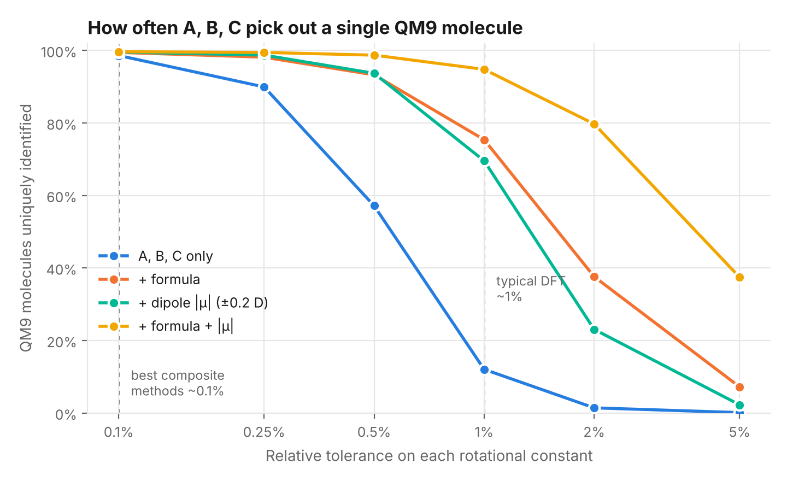
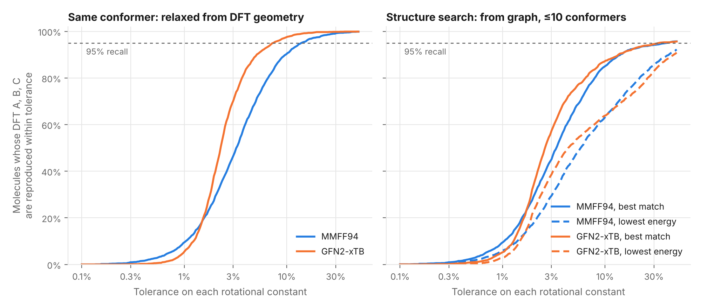
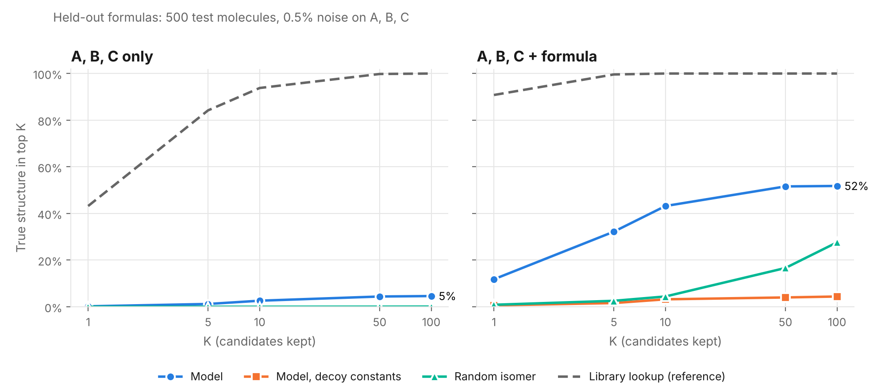
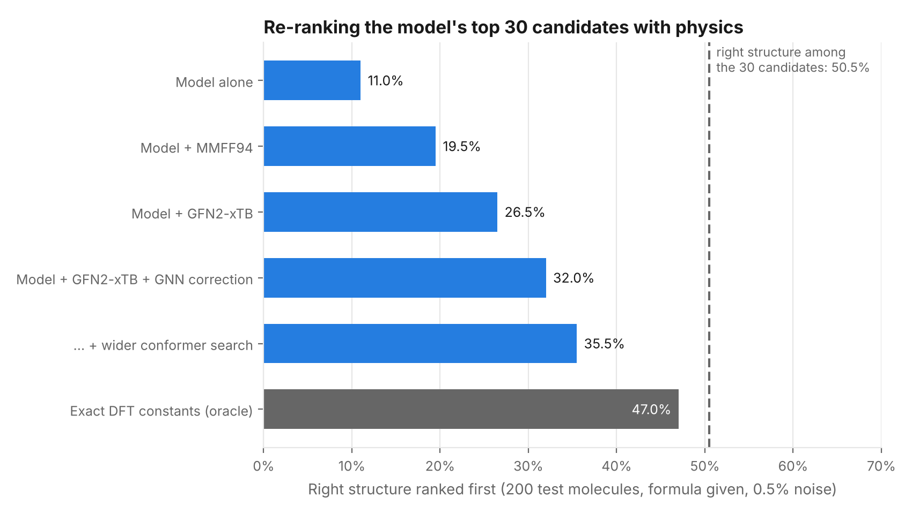
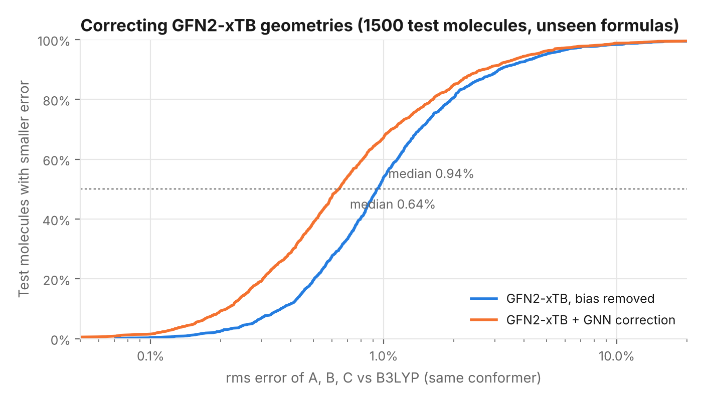

# Quantum-ML: molecular structure from rotational spectra

Research code for inferring the structure of **unknown** molecules from their
rotational / rovibrational spectra: an ML model proposes candidate structures,
and a funnel of increasingly accurate physics (force field -> GFN2-xTB -> DFT)
checks and ranks them. Applications: unidentified lines in radio-astronomical
surveys and unknown components of laboratory mixtures.

See [`docs/research_plan.md`](docs/research_plan.md) for the full plan, the
pipeline design and the closest prior work.

## Status

| Milestone | Status |
|---|---|
| 1. Identifiability of QM9 molecules from rotational constants | done |
| 2. Error of cheap geometry methods (MMFF94, GFN2-xTB) vs DFT | done |
| 3. Baseline inverse model (constants -> SELFIES transformer) | 3.8M-parameter CPU run done: with the formula, 43% top-10 recall on unseen formulas (random isomers: 4.4%). Without it, 2-3%; proposing formulas first lifts top-100 recall from 2% to 6%. Full 9.65M-parameter run needs a GPU |
| 4. KREED baseline and ablations | planned |
| 5. Full propose -> verify -> rank pipeline | prototype: re-ranking the top 30 candidates with GFN2-xTB, a GNN geometry correction and a wider conformer search lifts top-1 recall from 11% to 35.5% (formula given) |

## Milestone 1: how much do rotational constants pin down a molecule?

For each of the 133,885 QM9 molecules (B3LYP/6-31G(2df,p)), count how many
*other* QM9 molecules have A, B and C all within a relative tolerance.

Percentage of molecules **uniquely identified**, with the 90th percentile of
the number of other molecules that also match in brackets:

| Known observables | 0.1% | 0.5% | 1% | 2% | 5% |
|---|---|---|---|---|---|
| A, B, C | 98.6% (0) | 57.1% (2) | 12.0% (11) | 1.4% (66) | 0.1% (829) |
| A, B, C + formula | 99.5% (0) | 93.3% (0) | 75.4% (1) | 37.6% (5) | 7.2% (47) |
| A, B, C + dipole magnitude (±0.2 D) | 99.6% (0) | 93.7% (0) | 69.6% (1) | 23.1% (7) | 2.3% (80) |
| A, B, C + formula + dipole | 99.6% (0) | 98.7% (0) | 94.8% (0) | 79.7% (1) | 37.5% (7) |



Findings:

- **The accuracy of the theory is the bottleneck.** At 0.1% (best composite
  methods with vibrational corrections), rotational constants alone identify
  98.6% of QM9 molecules. At 1% (typical DFT) they identify only 12%.
- **Knowing the formula buys roughly a factor of 2-4 in tolerance**: with the
  formula, 1% tolerance identifies 75% of molecules; without it you need a
  tolerance between 0.25% (90%) and 0.5% (57%).
- **One extra observable helps nearly as much as the formula.** The dipole
  magnitude alone takes 1%-tolerance identification from 12% to 70%; formula
  and dipole together reach 95%.
- **Ambiguity grows quickly with size** (`results/m1/unique_vs_size.png`): at 1%
  with A, B, C only, 63% of 7-heavy-atom molecules are unique but only 8% of
  9-heavy-atom ones.

This agrees with Schwarting et al. (J. Chem. Phys. 2024, "Twins in rotational
spectroscopy"). Caveats: QM9 is a small, filtered corner of chemical space
with one conformer per molecule, so real unknowns face **more** look-alikes
than these counts suggest; and both "observed" and candidate constants come
from the same method here, so the tolerance stands in for theory-vs-experiment
error.

## Milestone 2: how accurate are the cheap funnel stages?

The first funnel stages use cheap methods, and a stage can only discard
candidates as aggressively as that method's error allows. For 2,000 random
QM9 molecules, A, B, C were recomputed with MMFF94 (RDKit) and GFN2-xTB
(tblite) and compared with the DFT values, in two settings:

- **Same conformer:** relax starting from the DFT geometry. This isolates the
  method's own error.
- **Structure search:** start from the molecular graph only, embed 10 ETKDG
  conformers, relax them, and take the best-matching (or lowest-energy) one.
  This is what a funnel stage actually faces.

The table gives the tolerance needed so that 95% of molecules still match.
The 90% and 99% columns are in `results/m2/error_summary.csv`; the GFN2-xTB
bias has been removed.

| Method | Setting | Median error per constant | Tolerance for 95% recall | Time per molecule |
|---|---|---|---|---|
| MMFF94 | same conformer | 1.8% | 14.1% | 2 ms |
| GFN2-xTB | same conformer | 1.6% (bias +1.1 to +1.7%) | **6.8%** | 0.3 s |
| MMFF94 | structure search, best match | 1.8% | 32% | 0.24 s |
| GFN2-xTB | structure search, best match | 1.7% | 30% | 1.8 s |
| either | structure search, lowest energy | 2.6–3.2% | ~90% | — |



**Run at its 95%-recall tolerance, each stage keeps this many QM9 candidates**
(median over all molecules, from the milestone 1 counts):

| Stage | Tolerance | A, B, C only | + formula |
|---|---|---|---|
| GFN2-xTB, right conformer | 6.8% | 798 (0.6% of QM9) | 23 |
| MMFF94, right conformer | 14.1% | 5,401 (4%) | 117 |
| GFN2-xTB, structure search | 30% | 27,781 (21%) | 461 |
| DFT-level, for comparison (M1) | 1% | 5 | 1 |

**Finding the right conformer is the main source of error, more than the
method's accuracy** (`results/m2/by_rotatable_bonds.csv`):

| Rotatable bonds | Molecules | GFN2-xTB, right conformer | GFN2-xTB, structure search |
|---|---|---|---|
| 0 | 870 | 6.0% | 6.5% |
| 1 | 579 | 7.4% | 15.7% |
| 2 | 328 | 9.4% | 22.1% |
| 3+ | 223 | 9.1% | 31.9% |

Findings:

- **GFN2-xTB beats MMFF94 by about 2x at 95% recall.** MMFF94's heavy tail
  comes from torsions relaxing into a different conformer, often one where
  the DFT structure was held by an intramolecular hydrogen bond. MMFF94 is
  about 100x faster, so it works as a loose pre-filter.
- **For rigid molecules, conformer search costs almost nothing.** With 2 or
  more rotatable bonds, 10 ETKDG conformers usually miss the right one, and
  the tolerance triples. A real funnel needs a proper conformer search (CREST)
  or a model that also predicts the conformer.
- **The lowest-energy conformer is a poor guess.** Part of this is a QM9
  artifact: each QM9 molecule is stored as one arbitrary conformer, not its
  global minimum. Cold molecular-beam and interstellar spectra come from
  low-energy conformers, so this needs re-testing against conformer-searched
  DFT references.
- **GFN2-xTB constants are about 1.1–1.7% too large compared with B3LYP.**
  This bias is easy to correct, but the spread, not the bias, sets the
  tolerance.
- **ETKDG cannot embed 3.6% of molecules** (strained polycyclic cages, 6.7%
  of the rigid set), so the funnel needs a fallback embedding route.
- **Even the best cheap stage leaves hundreds of candidates without a
  formula.** That is the room for an ML surrogate (GNN) that predicts
  DFT-quality constants from a cheap conformer, and for proposal models that
  start with fewer, better candidates.

Caveats: the reference is B3LYP, not experiment, and "right conformer" means
QM9's stored conformer.

## Milestone 3: inverse model (observables -> structure)

An encoder-decoder transformer that proposes candidate structures for a
molecule it has never seen, from its rotational constants and optionally its
formula and dipole magnitude.

| Part | Choice |
|---|---|
| Inputs | One encoder token per observable: log A, log B, log C, asymmetry kappa, inertial defect, dipole magnitude, element counts (C, H, N, O, F), noise level. Unknown observables are masked out of attention. |
| Output | SELFIES string of the stereo-free structure (enantiomers have identical rotational spectra). Up to 29 tokens, vocabulary of 53. |
| Model | 4-layer encoder, 6-layer decoder, d=256, 8 heads: **9.65M parameters**. Values enter through Fourier features so 0.1% differences are resolvable. Auxiliary head predicts the formula. |
| Training | Supervised, cross-entropy with label smoothing, AdamW with warmup and cosine decay. **One model for all conditions**: formula and dipole are each shown with probability 0.5, and noise on A, B, C is drawn from 0.1-1% (log-uniform) and given to the model. Fresh noise and a random SELFIES variant (of 5) each epoch. |
| Data | 127,035 QM9 molecules (valid graph, non-linear), **split by formula**: 107,625 train / 6,390 val / 13,020 test, with 499 / 26 / 85 formulas. Every test molecule has a formula never seen in training. |
| Evaluation | Recall@K: is the true structure among the top K deduplicated candidates (beam search + sampling, ranked by log-probability)? Reported per noise level and condition, next to the **library-lookup reference** (rank all 127k molecules, including the answer, by chi-square fit), which is close to the best achievable. |

**To train the full model on a GPU**, open [`notebooks/m3_train_colab.ipynb`](notebooks/m3_train_colab.ipynb)
in Google Colab with a GPU runtime. It clones the repo, builds the data,
trains with checkpoints on Google Drive (`--resume` survives disconnects), and
evaluates. On this repo's 4-CPU container the 9.65M-parameter model takes
about 15 min per epoch, so its 150-epoch run is a GPU job.

### CPU run: 3.8M parameters, 45 epochs

A smaller version (d=192, 3-layer encoder, 4-layer decoder: **3.82M
parameters**, `configs/m3_cpu_medium.json`) was trained for **45 epochs on 4
CPUs** (5.8 h, in resumable 100-minute chunks). Evaluation used **500
held-out test molecules** (formulas never seen in training) at 0.5% noise on
A, B, C, with beam 10 + 100 samples per molecule (`results/m3_cpu_medium/`).

"Recall@K" is how often the true structure is among the model's top K
candidates.

| Condition | Model recall@1 | @10 | @100 | Random isomer @1 / @10 / @100 | Library reference @1 / @10 |
|---|---|---|---|---|---|
| A, B, C | 0.2% | 2.6% | 4.6% | ~0 / ~0 / 0.1% | 43% / 94% |
| + formula | **11.8%** | **43.2%** | **51.8%** | 0.9% / 4.4% / 27.6% | 91% / 100% |
| + dipole | 0.6% | 6.0% | 9.0% | ~0 / ~0 / 0.1% | 88% / 100% |
| + formula + dipole | **14.2%** | **45.0%** | **54.0%** | 0.9% / 4.4% / 27.6% | 98% / 100% |
| + formula, **decoy constants** (control) | 0.6% | 3.2% | 4.4% | 0.9% / 4.4% / 27.6% | - |



Findings:

- **Given the formula, the model uses the rotational constants.** Its top-10
  list contains the right structure 43% of the time, against 4.4% for 10
  random isomers of the same formula (about 10x); for the top-1 guess it is
  12% against 0.9%. The **decoy control** settles where this comes from: when
  each molecule is given the constants of a *different* isomer with the same
  formula, recall for the true molecule falls to 3.2% at K=10, below even
  random isomers, because the model now proposes structures that fit the
  decoy constants.
- **Without the formula it is still weak** (4.6% at K=100), although that is
  about 60x better than random picks from all of QM9. Inferring the formula
  is the hard part: only 1% of top-1 candidates have the right formula on test
  molecules (8% on training molecules). With a formula split, every test
  formula is one the model has never produced, which is why removing the
  formula requirement is the research problem (milestone 4).
- **About half the time the right structure is not proposed at all.** With
  the formula, the 110 decodes give about 94 distinct candidates and recall
  stops rising after K=50 (51.6% at 50, 51.8% at 100). More sampling will
  add little; a stronger model is needed.
- **No overfitting to training formulas.** Recall on training molecules is
  similar (with formula: 11.6% / 38.4% / 47.6% at K=1/10/100; their formulas
  have more isomers, so they are slightly harder). Validation loss was still
  falling slowly at epoch 45. The 9.65M-parameter GPU run should help.
- **There is a large gap to the library reference** (91% top-1 with the
  formula). The library contains the answer, with exact constants, while the
  model has to generate it. Physics re-ranking (milestone 5) is the obvious
  next step: compute constants for the ~100 proposed candidates and re-rank by
  fit. With accurate enough constants, top-1 recall could approach the 52% of
  cases where the right structure is proposed. GFN2-xTB alone is too coarse
  for that (milestone 2: 6.8% tolerance), so this needs DFT or a DFT-quality
  surrogate.

### CPU pilot (1.4M parameters, 12 epochs)

The first end-to-end check (d=128, 3+3 layers, 49 min, 400 test molecules,
`results/m3_pilot/`) did not use the constants. With the formula it reached
1.0% / 5.8% / 11.0% at K=1/10/100, no better than random isomers (0.9% / 4.4%
/ 27.6%). Without the formula it reached 0% at every K. Train and test recall
were the same, so it was underfitting. Going from 1.4M parameters and 12 epochs
to 3.8M and 45 epochs took recall@10 with formula from 5.8% to 43%.

### Without the formula: propose formulas first

The structure model rarely writes a formula it has never seen. So a small
separate model predicts the formula from A, B, C
(`src/rotml/ml/formula.py`, `scripts/08_train_formula_model.py`). The
structure model is then run once for each of its top 20 formulas
(`scripts/09_eval_formula_proposals.py`), and the pooled candidates are ranked
by log p(formula) + log p(structure | formula).

**Formula model** on test molecules (formulas never seen in training), 0.5%
noise (`results/m3_formula/`). Each cell is how often the true formula is
among the top K proposals:

| Inputs | Top 1 | Top 10 | Top 20 | Top 50 |
|---|---|---|---|---|
| A, B, C | 0% | 2.5% | 22% | 47% |
| A, B, C + dipole | 0% | 4.2% | 21% | 52% |

**Structure recall without the formula**, on the same 200 test molecules:

| Method | @1 | @10 | @50 | @100 |
|---|---|---|---|---|
| Structure model alone | 0% | 1.0% | 2.0% | 2.0% |
| Structure model on the top 20 proposed formulas | 0% | 0.5% | 4.5% | 6.0% |

Findings:

- **Proposing formulas first triples recall at K=100, but it stays low.**
  The formula is the bottleneck. The true formula is in the top 20 proposals
  for only 23.5% of molecules. When it is there, the structure is found 23% of
  the time.
- **Predicting an unseen formula from A, B, C is hard, for two reasons.**
  The constants measure how mass is spread out, and C, N and O have similar
  masses (12, 14, 16), so many formulas give similar constants. Also, every
  test formula is missing from training. A model that predicts element counts
  one after another memorizes the training formulas: it gets the true formula
  into its top 50 less than 6% of the time. Predicting each element count
  independently generalizes much better (47%) but is imprecise. Training with
  more noise did not help.
- Ways forward: train on a much larger chemical space (so fewer formulas are
  truly new), model p(constants | formula) instead of p(formula | constants),
  or generate across many formulas and let physics decide (milestone 5).

## Milestone 5 (prototype): re-ranking candidates with physics

For 200 test molecules (formula given, 0.5% noise), each of the model's top
30 candidates was checked with physics (`scripts/07_physics_rerank.py`,
`src/rotml/analysis/rerank.py`):

1. Enumerate stereoisomers, keeping one per mirror-image pair (enantiomers
   have identical constants).
2. Embed ETKDG conformers, relax them with MMFF94 and then GFN2-xTB, and
   compute A, B, C for each conformer.
3. Score the candidate by its best-matching conformer, after removing
   GFN2-xTB's known bias (milestone 2).

Candidates were ranked by fit alone, or by fit plus the model's
log-probability. The combination uses a heavy-tailed (Student-t) likelihood
whose scale comes from milestone 2, fixed before looking at test results.
Results are in `results/m5_rerank/`.

| Ranking | Right structure first | Top 5 | Top 10 |
|---|---|---|---|
| Model alone | 11.0% | 30.5% | 44.0% |
| MMFF94 fit | 17.5% | 33.5% | 39.5% |
| Model + MMFF94 | 19.5% | 38.5% | 44.0% |
| GFN2-xTB fit | 26.0% | 40.5% | 44.5% |
| Model + GFN2-xTB | 26.5% | 43.0% | 45.5% |
| GFN2-xTB + GNN correction fit | 32.5% | 42.0% | 44.5% |
| Model + GFN2-xTB + GNN correction | 32.0% | 43.5% | 45.5% |
| **Same, with the wider conformer search** | **35.5%** | **47.0%** | **48.5%** |
| Exact DFT constants (oracle) | 47.0% | 50.0% | 50.5% |
| Ceiling: right structure among the 30 candidates | 50.5% | 50.5% | 50.5% |



Findings:

- **Physics re-ranking more than triples top-1 recall**, from 11% to 35.5%
  (bootstrap 95% CI of the gain 18 to 30.5 points). GFN2-xTB alone gives
  26.5% (+15.5 points, CI 9.5 to 21), the GNN correction (below) adds 5.5
  points (CI 2 to 9.5: it wins 13 molecules and loses 2), and the wider
  conformer search (below) adds 3.5 more (CI 1 to 6.5: 8 wins, 1 loss). For
  molecules whose formula the model has never seen, the right structure is
  now ranked first more than a third of the time.
- **It is cheap.** GFN2-xTB took about 1 CPU-minute per molecule for 30
  candidates, and the GNN correction adds well under a second. MMFF94 alone
  gives less than half the gain.
- **What is still lost.** With exact DFT constants for the candidates, top-1
  recall would reach 47%, close to the 50.5% ceiling. The right structure was
  proposed (101 molecules) but not ranked first by the full pipeline in 30
  molecules:
  - 22: a wrong candidate fit better (look-alikes, as in milestone 1). This
    was 28 before the GNN correction. Telling these apart needs more
    accurate constants (DFT on the top few) or more observables.
  - 6: the right structure's computed constants were off by more than 3%
    (12 before the wider search).
  - 2: no geometry could be made (5 before the wider search).

### GNN geometry corrector

GFN2-xTB geometries are close to DFT ones but not close enough: their
constants scatter by ~1% around B3LYP, so look-alike candidates are hard to
tell apart. The corrector (`src/rotml/ml/corrector.py`) is a small
equivariant GNN (0.25M parameters): SchNet-style message passing on
interatomic distances, then each atom moves along the directions to its
neighbours by learned amounts. Rotational constants are computed exactly
from the corrected geometry, so the network learns geometry, not constants,
and the constants cannot depend on orientation.

It was trained on 16,000 QM9 molecules from the training formulas: GFN2-xTB
relaxed from the DFT geometry (same conformer), with the B3LYP geometry and
constants as targets (`scripts/10_build_corrector_data.py`,
`scripts/11_train_corrector.py`; 30 epochs, 1.5 h on 2 CPU threads). On 1,500
test molecules from held-out formulas (`results/m5_corrector/`):

| Error per molecule (rms over A, B, C) | Median | 68th pct | 90th pct | 95th pct |
|---|---|---|---|---|
| GFN2-xTB, raw | 1.72% | 2.17% | 3.75% | 5.43% |
| GFN2-xTB, bias removed | 0.94% | 1.35% | 3.14% | 4.94% |
| **GFN2-xTB + GNN correction** | **0.64%** | **1.01%** | **2.69%** | **4.29%** |



The correction removes about a third of the typical error. The tail barely
moves. It comes from molecules where GFN2-xTB relaxes into a slightly
different conformer than DFT, which a local correction cannot undo. In the
re-ranking, the scoring scale was fixed from the validation molecules
(0.96% per constant), not tuned on test results.

### Wider conformer search

The default search embeds 10 ETKDG conformers spread over up to 8
stereoisomers. That misses rotamers of flexible molecules and cannot embed
some strained cages. The adaptive search (`--adaptive-search`,
`candidate_constants(..., adaptive=True)` in `src/rotml/analysis/rerank.py`):

- tries the same stereoisomers plus any RDKit can embed, then the rest, up to
  16;
- embeds 10 + 5 per rotatable bond conformers (up to 30), at least 3 per
  stereoisomer, and as many again with a permissive ETKDG (random starting
  coordinates, no torsion preferences) for other rotamers and strained rings.

On the same 200 molecules and candidates, the right structure's best
conformer error (bias-corrected GFN2-xTB, 90th percentile) drops from 11.5%
to 3.0%. Candidates left without GFN2-xTB constants drop from 6.1% to 3.5%. Top-1 recall
rises from 32.0% to 35.5%. It costs about 3.5 CPU-minutes per molecule for
30 candidates, against about 1 for the default search.

One trap on the way: RDKit's "can this stereoisomer be embedded" test makes
a single embedding attempt. Used as a filter, it dropped the right
stereoisomer of some cages, and the first version lost 2 molecules this way.
It is now used only to add stereoisomers.

**Next steps:** DFT on the few top-ranked survivors, to separate the
remaining look-alikes. The oracle row shows the most it can add (35.5% →
47%); it needs a GPU or a cluster (PySCF B3LYP optimisations take minutes to
hours per candidate on this CPU). Also a stronger proposal model (the GPU
run) to raise the 50.5% ceiling.

Caveat: the oracle can only score candidates that are QM9 molecules (59% of
them); the rest rank last. Since the right answer is always a QM9 molecule,
47% is an optimistic bound.

## Reproduce

```bash
uv venv .venv && source .venv/bin/activate
uv pip install -e ".[dev,xtb,ml]"
# CPU-only machines: uv pip install torch --index-url https://download.pytorch.org/whl/cpu
```

```bash
mkdir -p data/raw/qm9_molnet
curl -L -o data/raw/qm9_molnet/qm9.zip https://deepchemdata.s3-us-west-1.amazonaws.com/datasets/molnet_publish/qm9.zip
(cd data/raw/qm9_molnet && unzip qm9.zip)
```

```bash
python scripts/01_prepare_qm9.py              # ~1 min: data/processed/qm9.csv
python scripts/02_identifiability.py          # ~30 s: milestone 1 tables
python scripts/02b_plot_identifiability.py    # milestone 1 figures
OMP_NUM_THREADS=1 python scripts/03_cheap_method_error.py --n 2000 --workers 4   # ~18 min on 4 cores
python scripts/03b_analyze_cheap_methods.py   # milestone 2 tables, figure, link to milestone 1
python scripts/04_build_m3_dataset.py         # ~2 min: data/processed/m3/
python scripts/05_train_m3.py --config configs/m3_baseline.json --out runs/m3_baseline   # GPU
python scripts/06_eval_m3.py --run runs/m3_baseline --n-eval 2000 --samples 1000
# CPU run: repeat until all 45 epochs are done (each call stops cleanly after ~100 min)
python scripts/05_train_m3.py --config configs/m3_cpu_medium.json --out runs/m3_cpu_medium --resume --time-budget-min 100
python scripts/06_eval_m3.py --run runs/m3_cpu_medium --n-eval 500 --noise 0.005 --samples 100   # ~9 min per condition
python scripts/06_eval_m3.py --run runs/m3_cpu_medium --n-eval 500 --noise 0.005 --conditions "ABC + formula" --decoy-constants
python scripts/06b_plot_m3.py --results results/m3_cpu_medium   # after copying eval summaries there
python scripts/07_physics_rerank.py --run runs/m3_cpu_medium --out runs/m3_rerank --n 200 --top 30 --time-budget-min 100   # ~1 h on 4 cores; re-run to resume
python scripts/07b_plot_rerank.py --results results/m5_rerank   # after copying summary.csv there
python scripts/10_build_corrector_data.py     # ~45 min on 4 cores: GFN2-xTB vs DFT geometry pairs
python scripts/11_train_corrector.py --threads 2   # ~1.5 h
python scripts/11b_plot_corrector.py
python scripts/07_physics_rerank.py --run runs/m3_cpu_medium --out runs/m3_rerank --n 200 --top 30 --cache physics_geom.jsonl --keep-geometries --corrector runs/corrector/corrector.pt --summary-name summary_gnn.csv
# wider conformer search: ~3 h on 4 cores in 110 min chunks (re-run to resume)
python scripts/07_physics_rerank.py --run runs/m3_cpu_medium --out runs/m3_rerank --n 200 --top 30 --cache physics_adaptive.jsonl --keep-geometries --adaptive-search --corrector runs/corrector/corrector.pt --summary-name summary_adaptive.csv --time-budget-min 110
python scripts/08_train_formula_model.py --out runs/formula --threads 1   # ~4 min
python scripts/09_eval_formula_proposals.py --run runs/m3_cpu_medium --formula-model runs/formula/model.pt --n-eval 200 --top-formulas 20
pytest
```

QM9 comes from the MoleculeNet mirror because figshare (the original host)
blocks automated downloads.

**Data caveat:** in the MoleculeNet `gdb9.sdf`, bond orders and formal charges
are wrong for about 19% of molecules (25,173 have a net formal charge, although
every QM9 molecule is neutral). Read naively with RDKit, those records gain
implicit hydrogens and become different molecules. This code uses the SDF only
for atoms and coordinates, re-perceives bonds from the geometry with total
charge 0, and computes formulas from the explicit atoms. 6,837 molecules (5.1%)
have no valid neutral Lewis structure from their geometry; they keep their
constants and formula (milestone 1) but are excluded where a graph is needed
(milestone 2).

## Layout

```
src/rotml/
  physics/rotor.py               inertia tensor -> A, B, C, asymmetry, inertial defect
  data/qm9.py                    QM9 SDF + CSV loader
  analysis/identifiability.py    k-d tree match counting (milestone 1)
  analysis/cheap_methods.py      MMFF94 / GFN2-xTB / conformer search (milestone 2)
  analysis/rerank.py             physics re-ranking of proposed candidates (milestone 5)
  ml/features.py                 observable slots, noise, condition masks (milestone 3)
  ml/tokens.py                   SELFIES vocabulary and canonical comparison
  ml/dataset.py                  formula-split dataset build and batching
  ml/model.py                    encoder-decoder transformer
  ml/decode.py                   beam search, sampling, candidate ranking
  ml/metrics.py                  recall@K, library-lookup reference
  ml/formula.py                  formula proposals from rotational constants
  ml/corrector.py                equivariant GNN: GFN2-xTB geometry -> DFT-quality geometry
  plotting.py                    figure style
scripts/                         numbered pipeline steps
configs/                         training configs (GPU baseline, CPU medium, CPU pilot, tiny smoke test)
notebooks/m3_train_colab.ipynb   GPU training on Google Colab
results/m1, m2, m3_*, m5_*       summary tables and figures (large per-molecule files are gitignored)
tests/                           unit tests
docs/research_plan.md            plan, pipeline, prior work
```
